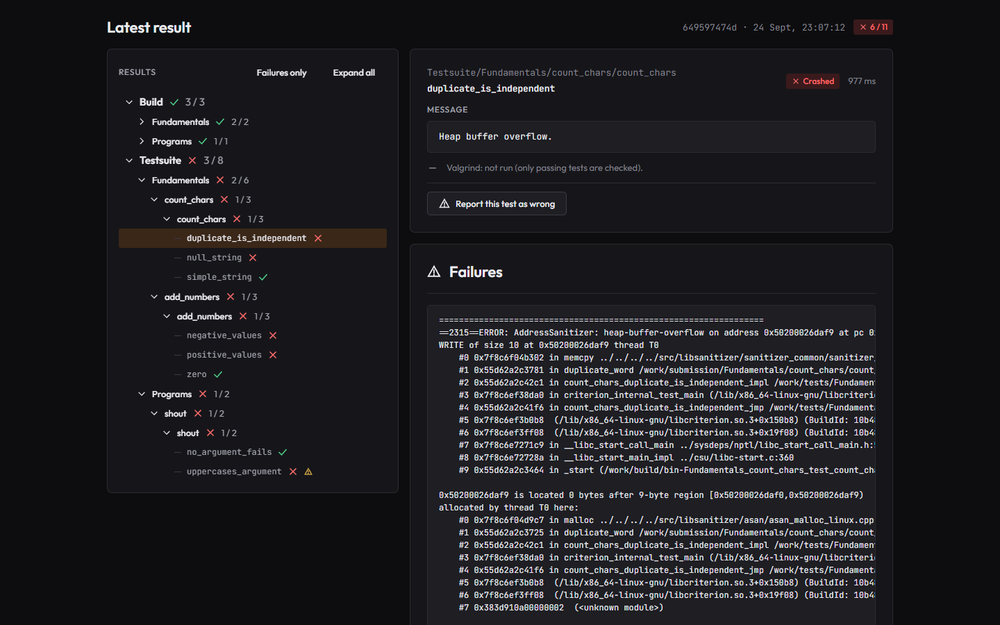
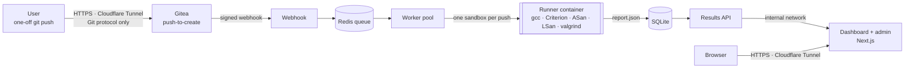
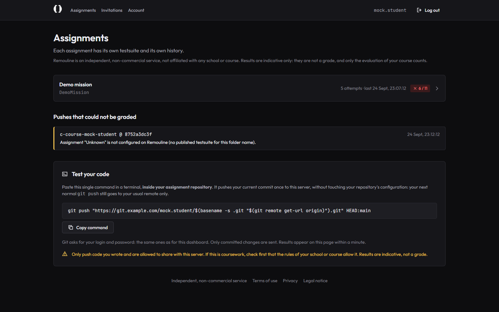
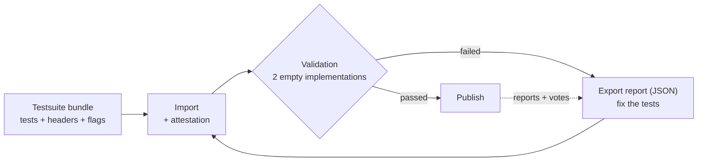
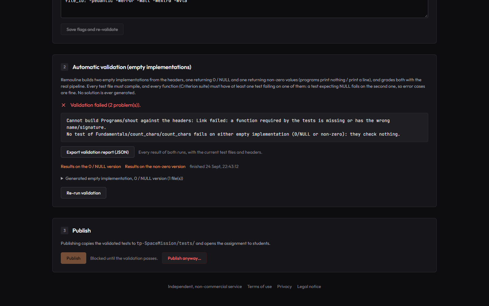
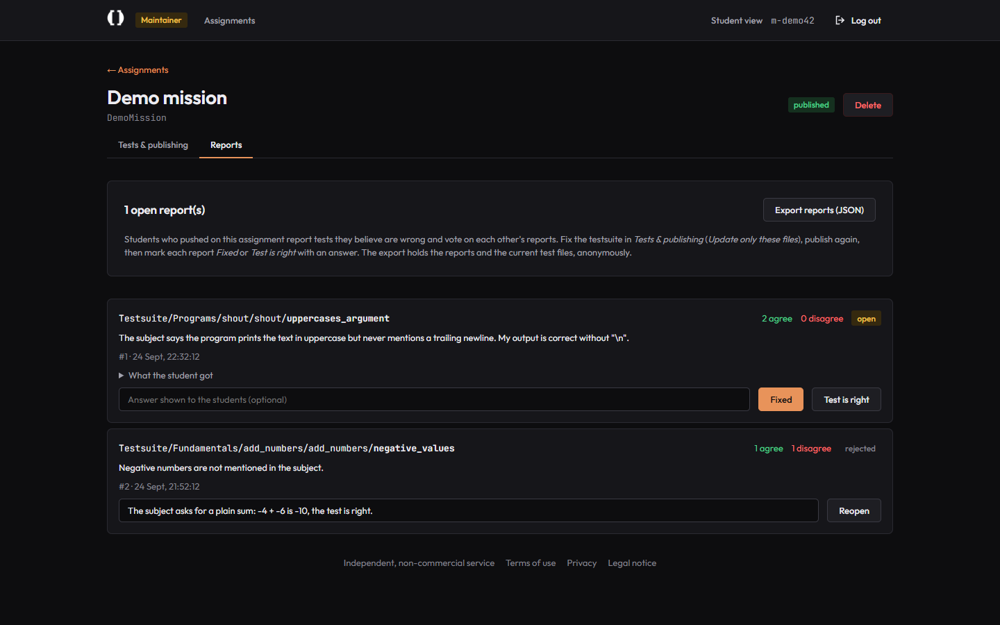

<p align="center">
  <picture>
    <source media="(prefers-color-scheme: dark)" srcset="docs/assets/logo-full-white.png">
    
  </picture>
</p>

<p align="center">
  <strong>Push as often as you want. Get a full test report in a minute.</strong><br>
  A self-hosted, invitation-only autograder for C assignments.
</p>

<p align="center">
  
  
  
  
  
  
  
  
  
</p>

<p align="center">
  <a href="#how-it-works">How it works</a> ·
  <a href="#adding-an-assignment">Adding an assignment</a> ·
  <a href="#security-and-privacy">Security and privacy</a> ·
  <a href="#responsible-use">Responsible use</a> ·
  <a href="#try-it-locally">Try it locally</a> ·
  <a href="docs/DEPLOYMENT.md">Deployment</a>
</p>

<p align="center">
  
</p>

---

Remouline tests C code the way an automated grader does, but as often as you like: a student
runs one command in their repository, and a detailed report appears on their dashboard a minute
later. It is meant for C courses, study groups, clubs and personal projects that write their own
[Criterion](https://github.com/Snaipe/Criterion) testsuites. Everything runs on a single small
server you control; nothing is ever sent to a third-party platform, and it never writes code for
anyone: users only get a verdict on their own code.

## Highlights

<table>
  <tr>
    <td width="33%" valign="top">
      <strong>One command, zero setup</strong><br>
      <sub>A one-shot <code>git push &lt;url&gt; HEAD:main</code>. No remote, alias or config file: the next plain <code>git push</code> still goes to the usual remote.</sub>
    </td>
    <td width="33%" valign="top">
      <strong>Reports you can act on</strong><br>
      <sub>Collapsible tree with pass counts at every level, expected vs actual with a diff, raw sanitizer / valgrind output, hex view for binary bytes.</sub>
    </td>
    <td width="33%" valign="top">
      <strong>Hard sandbox</strong><br>
      <sub>One container per push: no network, 256 MB, 1 CPU, 64 pids, read-only root, unprivileged user, per-test timeouts.</sub>
    </td>
  </tr>
  <tr>
    <td valign="top">
      <strong>Testsuites validated without a solution</strong><br>
      <sub>Each imported testsuite is graded against two generated empty implementations: tests that check nothing are caught before anyone sees them.</sub>
    </td>
    <td valign="top">
      <strong>Self-correcting testsuites</strong><br>
      <sub>Users report a test they believe is wrong and vote anonymously on each other's reports. Validation reports and reports export as JSON.</sub>
    </td>
    <td valign="top">
      <strong>Closed and private by design</strong><br>
      <sub>No sign-up page, separate operator and maintainer roles, automatic data deletion, account export and self-deletion, an emergency pause.</sub>
    </td>
  </tr>
</table>

## How it works



Everything runs with `docker compose` on a single small VM (2 vCPU, 4 GB). An outbound Cloudflare
Tunnel exposes exactly two hostnames, and no port is opened on the VM or the router:

- `app.<domain>`: the dashboard and admin panel;
- `git.<domain>`: **only** the three paths of the Git HTTP protocol. Gitea's web UI and API are
  never reachable from outside: users only ever see their terminal and the dashboard.

The API, the webhook receiver and Redis stay on the internal Docker network.

| Folder | Content |
| --- | --- |
| `server/` | Node.js backend: `src/webhook.js`, `src/worker.js`, `src/api/` (one image, three services) |
| `runner/` | Correction image `remouline-runner` + `pipeline.py` (build, Criterion, sanitizers, memory check) |
| `web/` | Next.js app: dashboard, `/admin` panel, shared design system |
| `tunnel/` | `cloudflared` configuration (example) |
| `scripts/backup.sh` | Nightly, encrypted, off-VM backup (Gitea dump + SQLite + assignments) |
| `examples/DemoMission/` | Demo assignment: `bundle.txt` to import, sample code (`correct/`, `broken/`) |
| `docs/` | [Deployment guide](docs/DEPLOYMENT.md), [bundle format](docs/BUNDLE-FORMAT.md), README assets |

### What happens on a push

1. The user pastes the command shown on their dashboard, inside their assignment repository:
   `git push "https://git.<domain>/<login>/$(basename -s .git "$(git remote get-url origin)").git" HEAD:main`
2. Gitea creates `<login>/<repo>` (private) on the first push and calls a signed system webhook.
3. The webhook stores a **new** submission (history is never overwritten) and enqueues a job.
4. A worker clones that exact commit and finds the **single top-level assignment folder** (e.g.
   `SpaceMission/`): that is the assignment. No published assignment with that name → a clear
   *not configured* status, never a crash.
5. The correction runs **only inside that folder**, in a fresh sandbox: `Build` (per exercise, with
   the assignment's flags) → `Testsuite` (each Criterion test alone, with AddressSanitizer / UBSan
   and a timeout) → memory check of passing tests: LeakSanitizer reports leaks of the user's code
   during the test itself (no extra run); valgrind only checks programs (`./name`, Makefile builds),
   which the sanitizers cannot see, or every test if LeakSanitizer cannot run in the sandbox. An exercise that does not build has its tests marked
   *Not run* instead of failing silently.
6. The job folder and container are always deleted. Docker or system failures show as
   *infrastructure error* (not a test failure) and can be re-run from the admin panel.

Per-user anti-spam: one running job and `MAX_JOBS_PER_HOUR_PER_STUDENT` starts per rolling hour;
over the limit, jobs wait, they are never dropped.

<p align="center">
  
</p>

## Roles

| Role | Can | Never sees |
| --- | --- | --- |
| **Student** | push, read their own results, report and vote on tests, invite others if sharing is on, export or delete their account | anyone else's code, results or identity |
| **Maintainer** | create assignments, import, validate and publish testsuites, answer reports | who the students are (reports are anonymous, only totals are shown) |
| **Operator** | invite students and maintainers, manage access, read logs, pause the service, edit the terms, privacy and legal pages, unpublish or delete an assignment | testsuite contents (managed by maintainers) |

Operators are listed in `OPERATOR_LOGINS`. Maintainers are invited from *Admin > Maintainers* and
get a **random pseudonymous login** (`m-xxxxxx`) without email. At every import they confirm they
have the right to use the material the tests are derived from; the attestation is recorded on the
server under that pseudonym only and is never exposed by the API.

## Adding an assignment



1. **Write a bundle**: Criterion tests, the headers users must write (declarations only) and the
   compilation flags, in one text document where each file starts with `===== FILE: <path> =====`
   (or a `.zip`). The format is documented in [`docs/BUNDLE-FORMAT.md`](docs/BUNDLE-FORMAT.md);
   `examples/DemoMission/bundle.txt` is a complete example.
2. **Tests & publishing**: paste or upload the bundle, confirm the attestation → *Import*.
3. **Validation, without any reference solution**: `server/src/stubs.js` generates two EMPTY
   implementations from the headers, one returning 0 / NULL and one returning non-zero values
   (programs print nothing / print a line). Both go through the real pipeline. Every test file must
   compile and link, and every Criterion suite (one per function) must have a test failing on one of
   them. A test expecting NULL fails on the second version, so legitimate NULL/0 results are never
   flagged. `void` functions (`free_*`, `destroy_*`) only warn: leaks are caught by the memory check
   on real runs.
4. Failed? The page lists the problems and exports a **validation report** (every result of both
   runs, with the current files) as JSON. Fix the tests and import only the changed files with
   *Update only these files*. Rare false positives can be overridden with **Publish anyway**
   (recorded in the activity log).
5. **Publish**: the validated tests and the flags they were validated with are frozen for users;
   later edits only reach them once validated and published again. Users can then report a test as
   wrong; everyone who pushed on the assignment votes. Maintainers answer each report, and can
   export them as JSON.

<p align="center">
  
  &nbsp;
  
</p>

<details>
<summary><strong>Test layout rules</strong></summary>

<br>

Test files mirror the assignment's folders:

```
Fundamentals/test_address_book.c                    -> Fundamentals/address_book.c (+ .h)
Fundamentals/preflight_check/test_preflight_check.c -> exercise folder Fundamentals/preflight_check/
Programs/shout/test_shout.c                         -> program exercise: tests run ./shout
fundamentals/test_physics.c                         -> project folder fundamentals/ (src/, include/, Makefile)
proficiencies/test_cannon.c                         -> project proficiencies/, module game_logic/cannon.c (+ .h)
```

- The exercise name is the file name without `test_` / `_test`. The result tree path is
  `Testsuite/<folders>/<exercise>/<Criterion suite>/<test name>`.
- Tests that run `./name`: every `.c` of the folder is compiled into `name`, or `make` builds it when
  the flags say `<folder>: makefile`. Otherwise → unit tests linked with the user's sources.
- Project folders (`src/`, `include/`, often a `Makefile`) tested module by module: every `.c` of the
  project except `main()` is linked with each test file, along with the project's precompiled
  libraries (`lib/*.a`), with every header folder on the include path. A project may also keep its
  modules in subfolders (`game_logic/cannon.c` + `cannon.h`, no `src/`): when one test file of a folder
  targets such a module, every test file of that folder tests the project. Object files given with the
  assignment (`display/display.o`, no `.c` next to them) are linked when the tests need them.
- A header including another exercise's header (`#include "../fleet/fleet.h"`) pulls that folder's
  `.c` files into the build. A top-level `include/` folder is on every include path.
- Helper functions a testsuite provides to users are defined in the test files and never redefined
  by the empty implementations.
- A test file that does not compile with the user's headers (missing prototype, wrong type) fails
  that exercise's build with an explicit message; during validation it blocks the testsuite.
- A failed build still lists every test of the exercise (as skipped), so totals are the same for
  everyone.
- Tests create their own data files (CSV, binary...) and run with the exercise folder as working
  directory.

</details>

<details>
<summary><strong>Compilation flags</strong></summary>

<br>

Each assignment has **its own** flags, used for user code (never for test files):

- **Default flags** from `remouline/flags.txt` in the bundle (`default: ...`).
- **Per-exercise exceptions** (`<exercise>: <flags>`), also editable in *Tests & publishing*;
  changing them re-runs the validation, and users get them at the next publication.
- The page shows where the flags come from (bundle or admin panel) and warns when the server
  fallback `DEFAULT_COMPILE_FLAGS` is used.
- Libraries are passed at link time (`-l*`, `-pthread`, always `-lm`). Dangerous flags (`-o`, `-B`,
  `-fplugin`...) are refused.
- `<folder>: makefile` when the assignment provides a Makefile: programs are built with it and the
  flags are read from it (`make -n`). Without that line, a submitted Makefile is never run.

</details>

<details>
<summary><strong>Readable failures</strong></summary>

<br>

- Every test result stores the expected and actual output (extracted from messages such as
  `Expected X but got Y`), the error message, and the raw sanitizer / leak / valgrind / compiler output,
  shown as-is in the **Failures** panel.
- Invalid UTF-8 and control bytes are escaped (`\xff`, `\x00`) by the pipeline and again by the UI,
  which also offers a hex view.

</details>

## Security and privacy

- **User code only runs in the sandbox**, on your own server.
- **No sign-up, anywhere.** Every account comes from a single-use invitation link (personal or
  open), where the person chooses their password and accepts the terms of use. Tokens are 24 random
  bytes, expiring, stored as SHA-256 hashes only.
- **Gitea stays invisible**: the dashboard has its own login form and checks the password against
  Gitea over the internal network; the tunnel only lets the Git protocol through. Accounts are
  private, the user list is disabled, no mail is ever sent. Failed logins are rate-limited per
  login and per address, in memory only.
- **Strict isolation**: the dashboard derives the user from a signed httpOnly session and the API
  scopes every query by that login. Changing an id in a URL returns 404. Admin routes use a separate
  token and re-check the role on every request.
- **Privacy by default** (GDPR-minded):
  - email optional;
  - pushes and results deleted `DATA_RETENTION_DAYS` after the push, repositories after `DATA_RETENTION_DAYS` without a push;
  - inactive accounts deleted after `ACCOUNT_RETENTION_DAYS`;
  - logs kept `LOG_RETENTION_DAYS`, without client addresses;
  - encrypted backups only;
  - users can export all their data and delete their account (repositories included) at any time.
- **Emergency pause**: one switch stops grading and invitations and shows a message on every page.
- **Terms, privacy and legal pages** editable by the operator; changing the terms makes every user
  accept the new version.

<details>
<summary><strong>Secrets</strong></summary>

<br>

| Secret | Used by |
| --- | --- |
| `GITEA_WEBHOOK_SECRET` | Gitea system webhook signature, checked by `webhook` |
| `GITEA_ADMIN_TOKEN` (`write:admin`, `write:user`, `write:repository`) | API: accounts, retention, setup script |
| `GITEA_CLONE_TOKEN` (`read:repository`) | worker: internal clones |
| `API_TOKEN` | dashboard → API, user routes |
| `ADMIN_API_TOKEN` | dashboard → API, admin routes |
| `NEXTAUTH_SECRET` | session signing key |
| `tunnel/credentials.json` | Cloudflare Tunnel |

All of them live in a non-committed `chmod 600` `.env` on the server (and `tunnel/`, also ignored).
Nothing is hardcoded.

</details>

## Responsible use

Remouline is a generic tool; each instance is run by its operator, who is responsible for how it is
used. In particular:

- **Content rights.** Only import tests derived from material you have the right to use. A bundle
  must never contain a solution or a copy of a subject: tests and declarations only.
- **Academic integrity.** If users push coursework, they must check that the rules of their school or
  course allow it. Results are indicative self-assessment, never a grade, and the service must not
  be used to copy or share solutions. The dashboard, the invitation page and the push instructions
  say so.
- **Personal data.** The operator is the data controller of their instance: fill in the contact,
  review the privacy notice and the retention periods, and answer requests.
- **Independence.** Do not present an instance as an official tool of any school or course.

The software is provided "as is", without warranty of any kind (see [LICENSE](LICENSE)).

## Try it locally

The whole UI runs without Gitea, the API or Docker, with fake users and data built from real
pipeline reports:

```bash
cd web && npm ci && npm run dev:mock
```

`/login` offers two students, a maintainer and an operator. Mock mode only exists under `next dev`
with `REMOULINE_MOCK=1`: production builds compile it out, so it can never be enabled in
production. It uses its own build folder and can run next to a normal `npm run dev`.

Checks:

```bash
cd server && npm ci && npm test
cd web && npm ci && npm run typecheck && npm run build
```

The pipeline also runs without Docker on any Linux box with `gcc` and `libcriterion-dev`:
`python3 runner/pipeline.py --work <dir> --slug DemoMission`, with `submission/`
(e.g. `examples/DemoMission/correct`), `tests/` and an empty `out/` in `<dir>`.

## Deploying

[`docs/DEPLOYMENT.md`](docs/DEPLOYMENT.md) covers everything from an empty Linux VM to the
end-to-end test: Docker, Cloudflare Tunnel, Gitea, the operator account, backups and updates.

<details>
<summary><strong>Design system</strong></summary>

<br>

`web/src/theme/theme.ts` is the single source of truth for colors (with measured WCAG contrast),
type scale, spacing, radii, logo rules and icon geometry, shared by the dashboard and the admin
panel. Logos live once in `web/public/branding/`; the black artwork is rendered white in the app
with `filter: brightness(0) invert(1)`. Favicons come from `logo-mark.png` only
(`python web/scripts/generate-favicons.py`), the README's dark-mode logo from
`python docs/assets/make-readme-logo.py`.

</details>

<details>
<summary><strong>Growing later</strong></summary>

<br>

- More throughput: `docker compose up -d --scale worker=N`, or workers on another VM sharing the same
  Redis (`REDIS_URL`) and data.
- Redis → any managed Redis by changing `REDIS_URL`. SQLite → the data layer is isolated in
  `server/src/db.js` and plain SQL, portable to Postgres/libSQL.

</details>

## License

[MIT](LICENSE). The name of an instance is a single setting (`APP_NAME`).
